<div align="center">

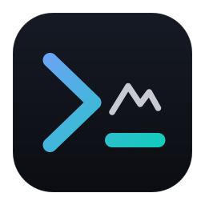

# Fjord

**Local-first project management — Linux first, also on Windows & macOS. Built for the keyboard, friendly to the mouse, and open to AI agents.**

[](https://www.bestpractices.dev/projects/15314)
[](https://scorecard.dev/viewer/?uri=github.com/jhtjernsmo/fjord)
[](https://github.com/jhtjernsmo/fjord/actions/workflows/ci.yml)


[](https://appimage.github.io/Fjord/)


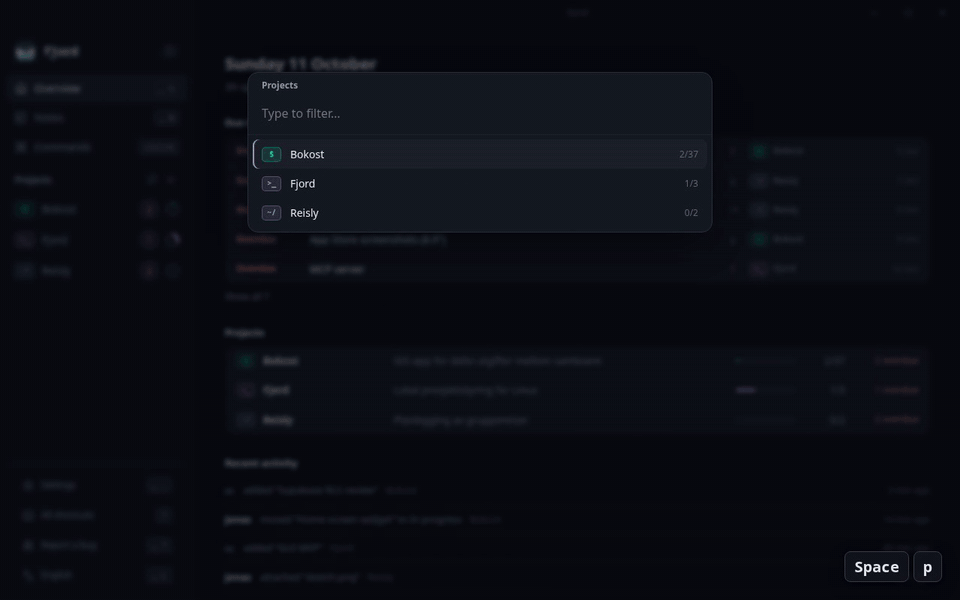

</div>

Fjord keeps your projects, kanban boards, files and notes in a single SQLite database on your own
machine. No account, no cloud, no telemetry. It's a lightweight native desktop app (Tauri), a scriptable
CLI, and an [MCP](https://modelcontextprotocol.io) server — so you and your AI assistant can work in
the same projects, and you can always see who did what.

## Features

- **Projects & kanban boards** — drag and drop, or move tasks with `H`/`L`. Rename, recolor, reorder and add columns, and mark one or more as done columns (e.g. Resolved and Done). Right-click a project to change its icon and colour.
- **Tasks** — markdown descriptions, priority, due dates, overdue warnings, archive & restore. Move a task to another project with its subtasks and files, or pop it out into its own window to keep beside the board or on another monitor. The Overview lists everything due this week across your projects, overdue first.
- **Standup and Waiting on you (beta)** — on your standup days the Overview drafts the standup for one project (done, in progress, your PRs, where you were mentioned) to copy as text, and lists pull requests waiting for your review or with failed checks. Both are off by default; turn them on in **Settings → Overview**, where every Overview section can be switched on or off.
- **Files** — drop files onto the window to attach them to a project or task. Stored content-addressed (deduplicated) with image previews.
- **Themes** — five built-in themes (Fjord Dark/Light, Nord, Solarized Light, High Contrast), follow the OS with separate light/dark picks, or build your own with live preview: colours, text size, rounding and density; share themes as JSON. `Space T` cycles themes.
- **Pending** — mark a task as waiting on someone else, such as a reply from the client (`w`, right-click, or the task panel). It stays in its column with a “pending 3d” badge, can be filtered on, is listed on the Overview with the longest waiting first, and shows up as a blocker in the standup. Tasks from Azure Boards follow their work item both ways: a work item set to *Pending* in Azure becomes pending in Fjord, and marking it pending in Fjord moves the work item there (and back when you clear it).
- **Subtasks** — break a task into subtasks (one level) with their own status, priority and branch, or make an existing task a subtask of another (and back); cards show progress (2/5), the task panel lists them with check-off, drag to reorder and `A` to add.
- **Notespace** — Obsidian-style markdown notes, inside a project or free-floating, in folders and subfolders (drag a note onto a folder, sort by name or date), with pins and notes you can lock to read-only. Link anything with `[[Project]]`, `[[#12]]` (a task) or `[[Another note]]` — type `[[` for autocomplete — and see backlinks (“mentioned in”) on tasks, projects and notes. Tables, task lists and [Mermaid](https://mermaid.js.org) diagrams render in notes and task descriptions; web links open in your browser.
- **Full-text search** across tasks, notes and file names (`Space f`).
- **Keyboard-first** — a leader key with a which-key popup, vim motions on the board, a `Ctrl+K` command palette, and every binding configurable. The mouse works for everything too.
- **Git, GitHub & Azure DevOps** — link a project to a repo, start a branch with a conventional name from any task (`B`, e.g. `feat/12-add-login`) or link an existing one, see pull requests with CI status, open PRs from a task, and let merged PRs move tasks to done.
- **Azure Boards import** — work items assigned to you show up as tasks in the project you choose, with their state mapped to your columns, child items as subtasks, attachments and screenshots, and the discussion readable in the task. Optional (beta): send a story analysis's acceptance criteria and risk back to the work item, and reply in its discussion. Work items where someone @mentions you show up in the Overview.
- **VS Code extension** — [Fjord for VS Code](https://github.com/jhtjernsmo/fjord-vscode) shows the board next to your code and the current branch's task in the status bar. See [VS Code](#vs-code).
- **AI-agent ready** — `fjord mcp` exposes 28 tools to MCP clients such as Claude Code and Cursor, and an [Agent Skill](#agent-skill) teaches agents how to use them. Agents can create, edit, move and archive but never hard-delete, and every change is tagged with its author.
- **Activity log** — what changed, when, and by whom (you or an agent).
- **Live updates** — changes from the CLI or an agent appear in the open app within a second or two.
- **English and Norwegian** — English by default; adding a language is one file.
- **Updates itself** — signed in-app updates; Settings shows the installed version.

<table>
  <tr>
    <td>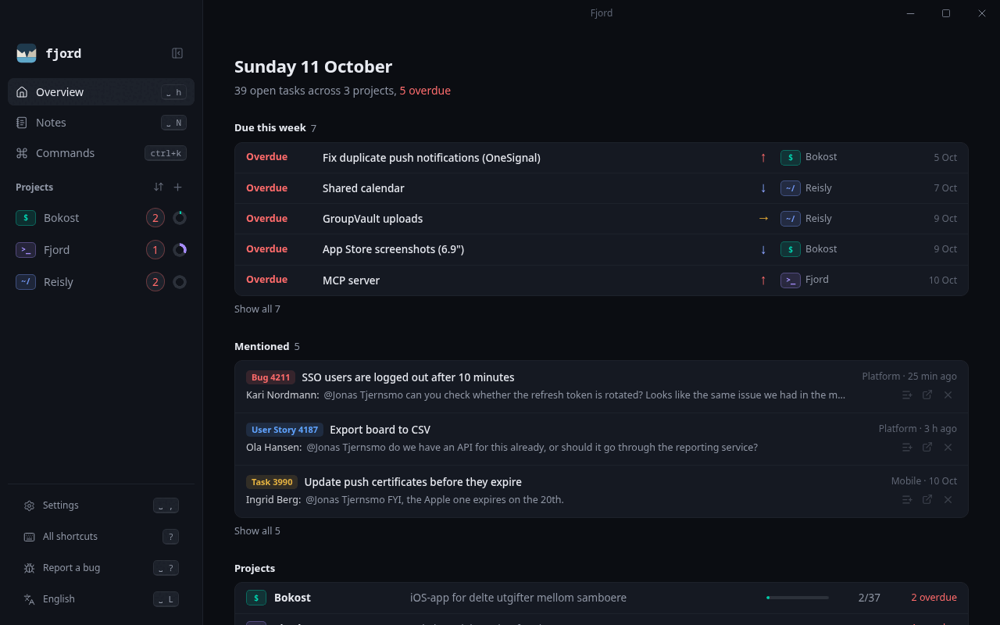</td>
    <td>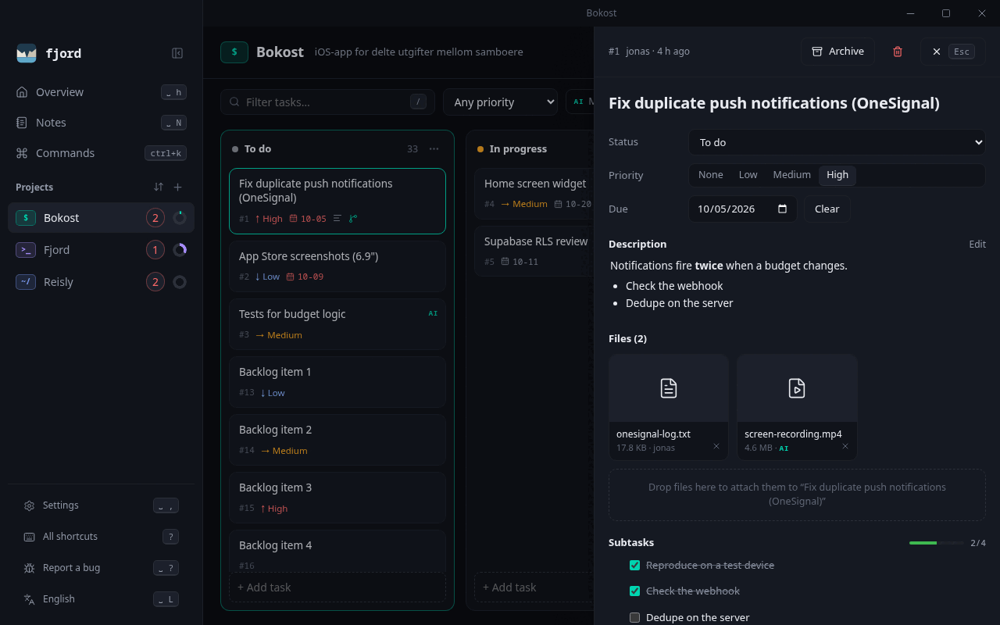</td>
  </tr>
  <tr>
    <td>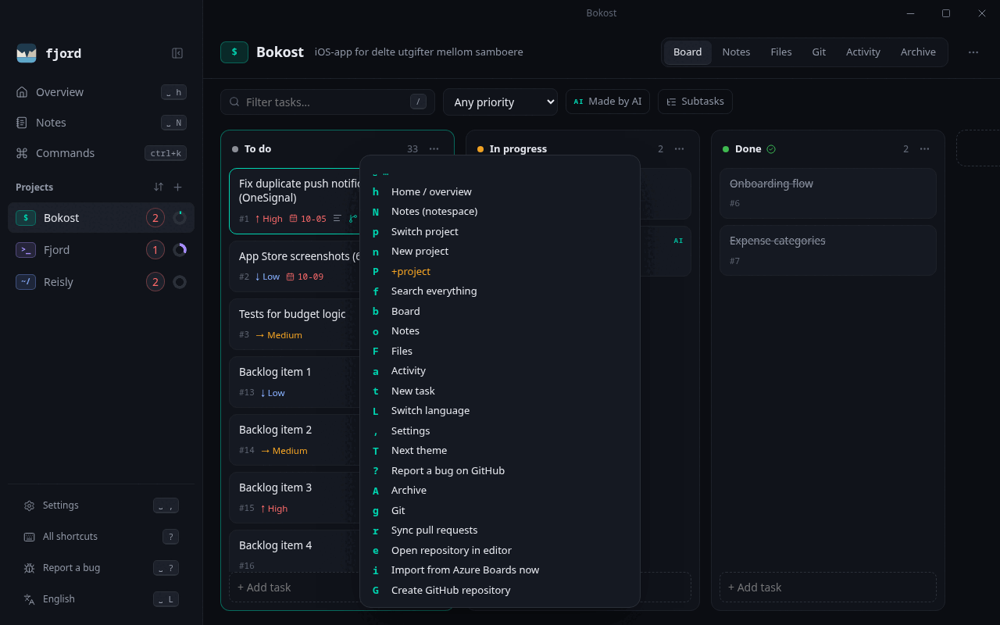</td>
    <td>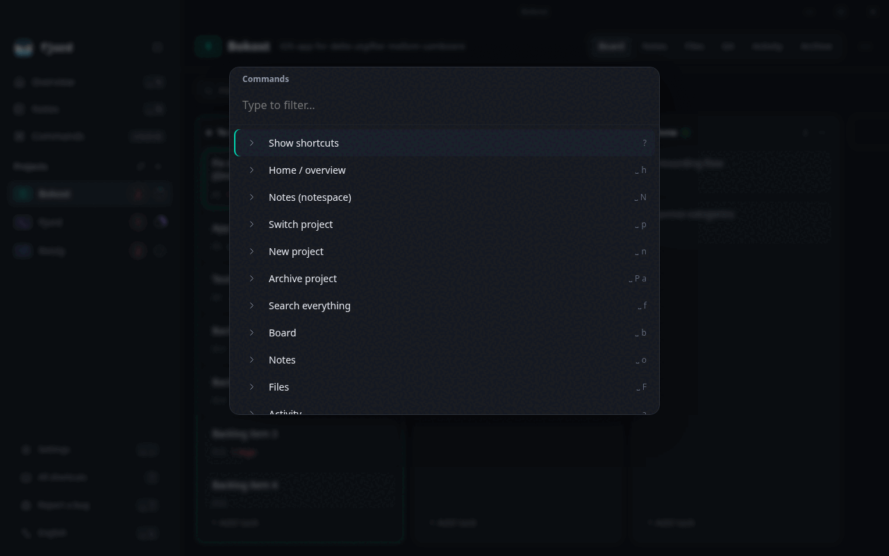</td>
  </tr>
  <tr>
    <td>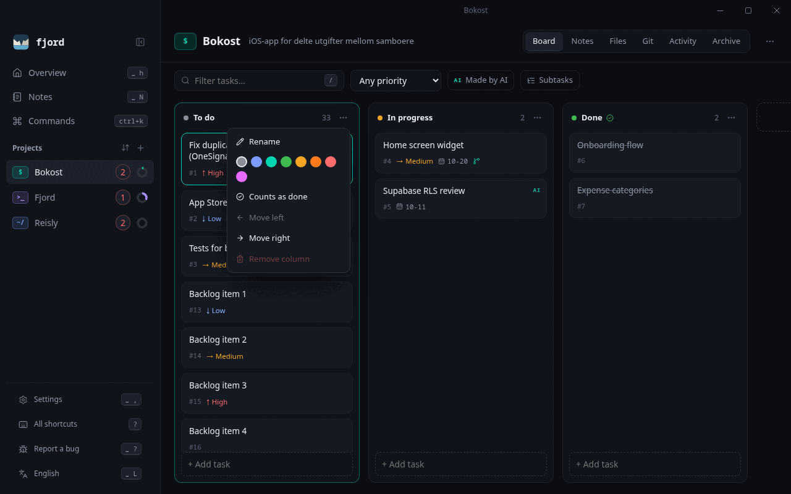</td>
    <td>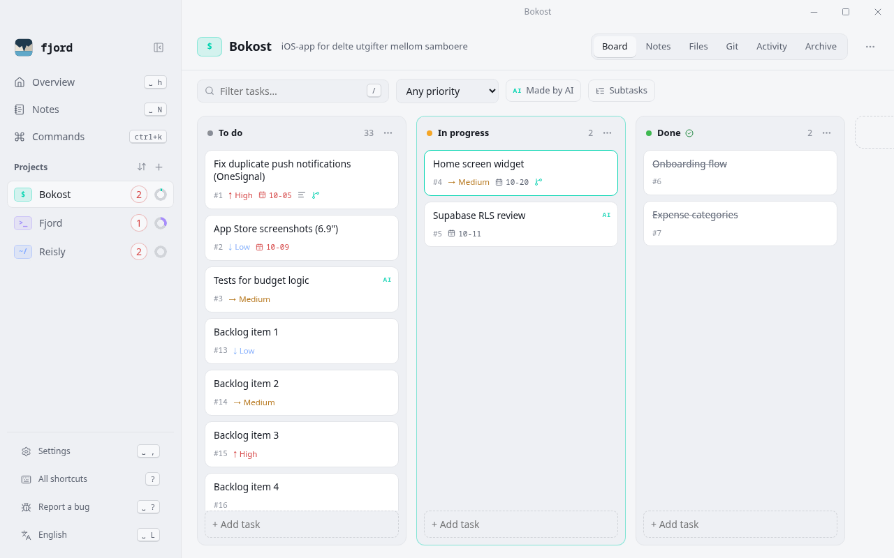</td>
  </tr>
</table>

## Install

Fjord is **Linux first**: that's where it's developed and used daily. Windows and macOS builds come
from the same code and are tested in CI on every pull request.

### Download

Grab the installer for your system from [Releases](https://github.com/jhtjernsmo/fjord/releases):

| System | File |
|---|---|
| Linux | `.AppImage` (any distro), `.deb` (Debian/Ubuntu), `.rpm` (Fedora/openSUSE) |
| Windows 10/11 | `.msi` or `-setup.exe` |
| macOS | `.dmg` (Apple Silicon or Intel) |

On macOS (and for the CLI on Linux) you can also use Homebrew:

```sh
brew install --cask jhtjernsmo/fjord/fjord   # the app
brew install jhtjernsmo/fjord/fjord-cli      # the `fjord` command-line tool
```

The CLI is attached separately as `fjord-cli-<platform>`. From 0.2.9 the macOS app is signed with
an Apple Developer ID and notarized, so it opens normally. Windows builds aren't code-signed yet and
may show a SmartScreen warning (More info → Run anyway).

### Build from source

**Requirements:** Rust (stable), Node.js 20+. On Linux also WebKitGTK 4.1; Windows uses the
built-in WebView2, and macOS needs the Xcode command line tools.

```sh
# Arch
sudo pacman -S --needed webkit2gtk-4.1 base-devel
# Debian / Ubuntu
sudo apt install libwebkit2gtk-4.1-dev build-essential libssl-dev librsvg2-dev
# Fedora
sudo dnf install webkit2gtk4.1-devel openssl-devel librsvg2-devel
```

```sh
git clone https://github.com/jhtjernsmo/fjord.git
cd fjord
npm --prefix ui install
npx --prefix ui tauri build          # installers for your OS in target/release/bundle
./target/release/fjord-app           # run it

cargo install --path crates/fjord-cli  # optional: puts `fjord` on your PATH
```

For development with hot reload: `npx --prefix ui tauri dev`.

### Updates

From 0.2.1 on, Fjord checks GitHub Releases on startup and offers **Update & restart** (Windows, macOS and the Linux AppImage; `.deb`/`.rpm` update via your package manager). Updates are signed and verified before installing; the check can be turned off in Settings. **Settings → Updates** shows the installed version and has a *Check now* button. Versions before 0.2.1 have no updater, so install the latest release once by hand.

## Keyboard

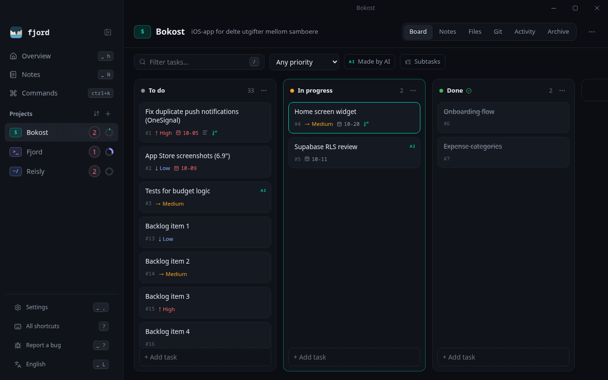

Press `?` in the app to see every shortcut. Press the leader key (`Space`) and wait a moment to see
what comes next.

| Keys | Action | Keys | Action |
|---|---|---|---|
| `Ctrl+K` | Command palette | `h` `j` `k` `l` | Move around the board |
| `Space p` | Switch project | `H` / `L` | Move task to previous/next column |
| `Space t` | New task | `J` / `K` | Move task down/up |
| `Space f` | Search everything | `Enter` | Open task |
| `Space n` | New project | `o` | New task in this column |
| `Space b` `o` `F` `a` `A` | Board, notes, files, activity, archive | `x` | Toggle done |
| `Space ,` | Settings | `d d` | Archive task |
| `Space L` | Switch language | `p` | Cycle priority |
| `Space N` | Notespace | `/` | Filter the board |
| `Space g` | Git tab | `B` | Start branch for task |
| `Space r` | Sync pull requests | `a` | Add subtask to task |
| `Space i` | Import from Azure Boards | `S` | Show or hide subtasks |
| `Space T` | Cycle themes | `y` | Copy task reference (`[[#12]]`) |
| | | `w` | Pending on/off (waiting on the client) |
| `Space ?` | Report a bug | `g g` / `G` | First / last task |
| `Esc` | Close | `Delete` | Delete task |

On the Overview: `j` / `k` move through due tasks, mentions and projects, `Enter` opens, `a` adds a
mention as a task and `x` dismisses it. `Space G` creates a GitHub repository for the current project.
`Ctrl+B` collapses the sidebar to icons, like in VS Code.

In an open task: `[` / `]` move it to the previous/next column, `e` edits, `A` adds a subtask, `B`
starts a branch, `L` links an existing one, `P` opens a pull request, `m` moves it to another project,
`o` pops it out into its own window and `N` makes it a subtask of another task (or a regular task again).

On macOS, `Ctrl` shortcuts use `⌘` instead. Remap anything in `keymap.json` (see [Data](#data) for where it lives):

```json
{
  "leader": "space",
  "bindings": {
    "task.archive": "D",
    "search.open": "<leader>/"
  }
}
```

Action ids are listed in [`ui/src/keymap.ts`](ui/src/keymap.ts).

## Command line

```sh
fjord project add "Bokost" --icon '$'
fjord task add bokost "Fix push notifications" -p 3 --due 2026-10-10
fjord column add bokost Review
fjord task move 1 review
fjord task done 1
fjord task nest 3 1                # make #3 a subtask of #1 (unnest to undo)
fjord project show bokost          # board in the terminal
fjord search push
fjord log bokost                   # activity
fjord --json project ls            # JSON for scripts
```

Run `fjord --help` for everything. Changes are recorded with an actor: `--actor`, `$FJORD_ACTOR` or `$USER`.

## Git & GitHub

Link a project to a repository in the **Git** tab (or `fjord git link <project> <path>`). No
repository yet? Tick **Also create a repository on GitHub** when you make a project, or use the Git
tab: Fjord creates it (private or public, under you or an organization, with an optional README,
`.gitignore` and license), clones it and links it in one step. A local repository without a remote
can be published the same way. If you aren't signed in to GitHub, you can sign in right there.

Once a project is linked, Fjord:

- starts a branch for a task with a conventional name — `fix/12-fix-push-notifications`. Pick the type (feat, fix, chore, docs, refactor, test, perf, ci, hotfix) in the task, or let Fjord guess: `fix` for bug-like tasks and Azure Bugs, `feat` otherwise. The task moves to the second column,
- or links a task to a branch that already exists. Several tasks can share one branch, and its pull request shows on all of them,
- shows branches, recent commits and GitHub pull requests with their CI status,
- links pull requests to tasks by branch name, and opens a PR straight from a task (the title follows the branch type, e.g. `feat: Add login`, and the description comes from the task),
- opens the repository in your editor or IDE (VS Code, Cursor, JetBrains IDEs, Visual Studio, Zed, Sublime, or your own command; set in **Settings → Integrations**), on the task's branch, with `Space e`,
- moves the task (or all tasks on the branch) to done when the PR is merged (on **Sync**), unless you turn auto-move off.

If GitHub or Azure DevOps refuses access, the Git tab shows their own explanation, for example an
organization that restricts OAuth apps or requires SSO approval.

Git runs through your installed `git`, so your config, hooks and credentials apply. GitHub access
(needed for private repositories and opening PRs) comes from, in order: `GITHUB_TOKEN`/`GH_TOKEN`, a
**Sign in with GitHub** in Settings (browser sign-in, OAuth device flow) or a personal access token pasted there, or `gh auth login`. A connected token is
checked with GitHub and kept in the OS credential store (Windows Credential Manager, macOS Keychain,
Secret Service on Linux), never in Fjord's database or files. Public repositories can be read without one.

**Azure DevOps (beta).** Repositories on `dev.azure.com` (and the older `visualstudio.com` URLs) are
detected the same way and get the same features: pull requests with pipeline status, a branch per
task, opening PRs from a task, and moving tasks to done when their PR completes. Auth comes from
`AZURE_DEVOPS_EXT_PAT`, a personal access token per organization in **Settings → Azure DevOps**
(scopes: Code Read & Write, Build Read; stored in the OS credential store), or the Azure CLI: add the organization in Settings without a token and Fjord uses `az login`.

**Azure Boards import (beta).** Work items assigned to you can be imported into chosen Fjord projects
(on start and every 10 minutes, no duplicates). Each item lands in the column named like its Azure
state (Active falls back to your in-progress column, New to the first), child items become subtasks,
items finished in the last 30 days (configurable) are included, and a notification tells you what
was added or changed. The task panel shows the work item's discussion. An AI agent can analyze new ones through the MCP
server (`import_azure`, `list_new_imports`, `mark_analyzed`). Setup, a ready-made triage prompt and
how to schedule it: [docs/azure-boards-triage.md](docs/azure-boards-triage.md).

**Pending.** A work item in the state named in **Settings → Integrations → Pending state**
(*Pending* by default) is pending in Fjord. Marking an imported task pending in Fjord moves its work
item to that state, and clearing it moves the work item back to the state it had before. The state
has to exist for the work item type in your Azure process, and writing it needs permission to edit
work items (your `az login`, or a token with Work Items Read & Write). If Azure refuses, the task is
still marked in Fjord and Fjord tells you why. Leave the setting empty to keep pending local.

**Mentions.** When someone @mentions you in a work item that isn't assigned to you, the Overview
shows it under **Mentioned**: the item, who mentioned you and what they wrote. Open it in Azure, add
it to a project as a task, or dismiss it. New mentions also get a notification. This uses Azure
DevOps' own "recent mentions" (the last 30 days, Azure DevOps Services only).

| | |
|---|---|
| 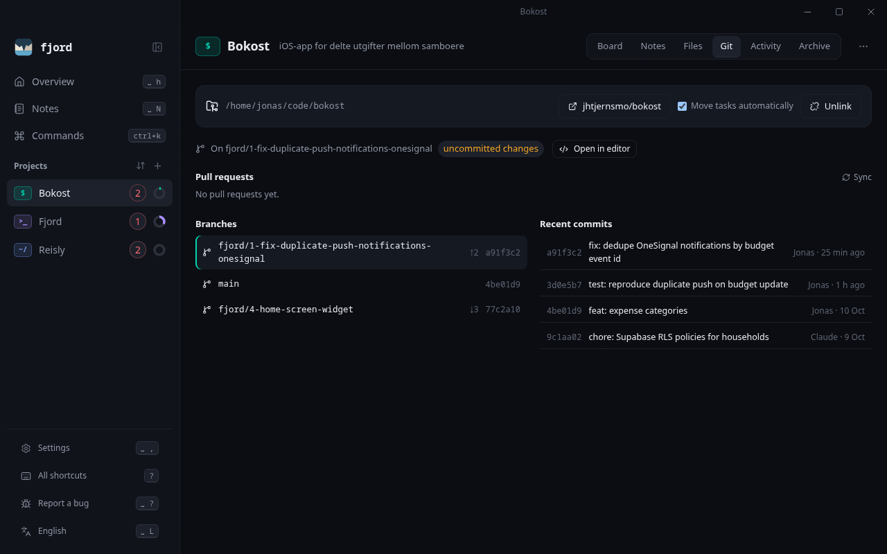 | 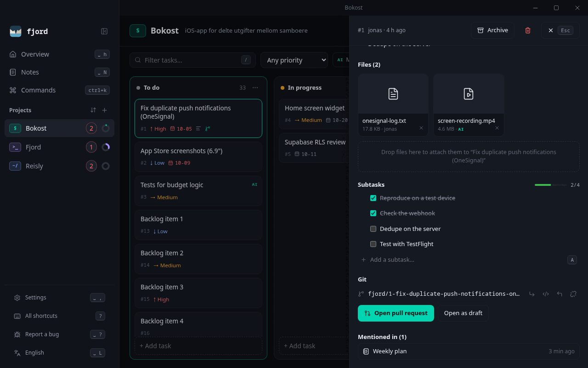 |

```sh
fjord git link bokost ~/code/bokost
fjord git branch 12          # check out (or create) the task's branch
fjord git main bokost        # back to the main branch
fjord git status bokost      # branches and recent commits
fjord git prs bokost         # pull requests + CI; moves merged tasks to done
fjord git pr 12 --draft      # push the branch and open a pull request
fjord git which              # the project and task for the current folder
fjord azure import           # import Azure Boards work items (same settings as the app)
fjord azure links bokost     # the work items behind a project's imported tasks
fjord notes list --folder Work            # notes in a folder and its subfolders
fjord notes move 7 --folder Work/Meetings  # sort a note into a folder
fjord notes rename-folder Work Jobb        # rename a folder and everything under it
fjord notes lock 7 on                      # open read-only in the app
```

## VS Code

[Fjord for VS Code](https://github.com/jhtjernsmo/fjord-vscode) puts the board of the project linked to the open folder in the Explorer, and the task for the branch you're on in the status bar.

- start a task (checks out its branch), move it, mark it done or open a pull request from the editor
- link a folder to a project, and find or download the `fjord` CLI, without leaving VS Code
- an empty commit message starts with `#12 ` while you're on task 12's branch
- right-click a TODO to turn it into a task that links back to the line
- runs the Azure Boards import every 10 minutes, so work items arrive even when the app is closed

It needs the `fjord` CLI 0.2.18 or later and talks to the same local database as the app. Install the `.vsix` from the [extension's releases](https://github.com/jhtjernsmo/fjord-vscode/releases/latest) (`code --install-extension fjord-*.vsix`).

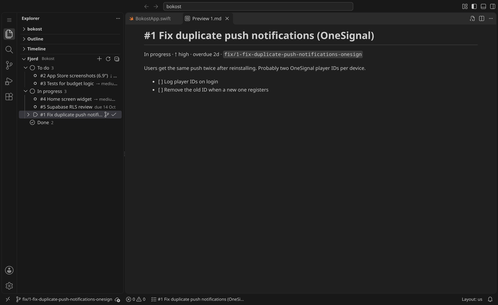

## AI agents (MCP)

`fjord mcp` runs a [Model Context Protocol](https://modelcontextprotocol.io) server on stdio. Changes it
makes are recorded as `claude` (override with `--actor`) and shown with an **AI** tag in the app.

It needs the `fjord` command-line tool on your PATH (see [Install](#install)). With Claude Code:

```sh
claude mcp add fjord -- fjord mcp
```

Cursor (`~/.cursor/mcp.json`) and other clients:

```json
{ "mcpServers": { "fjord": { "command": "fjord", "args": ["mcp"] } } }
```

Tools: `list_projects`, `get_board`, `create_project`, `create_task`, `get_task`, `update_task`, `move_task`,
`complete_task`, `set_task_pending`, `archive_task`, `add_note`, `attach_file`, `search`, `recent_activity`, `link_repo`,
`git_status`, `start_branch`, `link_branch`, `list_pull_requests`, `open_pull_request`, `list_notes`, `get_note`, `update_note`, `backlinks`, `analyze_story`, `import_azure`, `list_new_imports`, `mark_analyzed`. There is deliberately no
delete tool.

### Agent Skill

The MCP tools say what each one does; the [Fjord skill](skills/fjord/SKILL.md) teaches an agent how
to use them together: look at the board before changing it, keep what you wrote in a description,
plan work into tasks, take a task from branch to pull request, analyse a story, triage Azure imports.
Install it for Claude Code and Cursor (both read `~/.claude/skills`):

```sh
fjord skill install
```

`fjord skill install --dir .claude/skills` puts it in a repository instead, and `fjord skill` prints it.
With a CLI older than 0.2.27, copy the [`skills/fjord`](skills/fjord) folder into `~/.claude/skills/` by hand.

## Data

| | Linux | Windows | macOS |
|---|---|---|---|
| Data (`fjord.db`, `files/`) | `~/.local/share/fjord` | `%APPDATA%\fjord` | `~/Library/Application Support/fjord` |
| Keymap (`keymap.json`) | `~/.config/fjord` | `%APPDATA%\fjord` | `~/Library/Application Support/fjord` |

Settings in the app shows the exact paths. Set `FJORD_DATA_DIR` / `FJORD_CONFIG_DIR` to use other
locations (for example a separate test database). Back up by copying the data folder.

## Architecture

```
crates/fjord-core   Rust library: schema & migrations, projects, columns, tasks, files, notes, search, activity
crates/fjord-vcs    Git (via the git CLI), GitHub and Azure DevOps REST integration
crates/fjord-cli    `fjord` CLI and MCP server
src-tauri           Tauri desktop shell — thin commands over fjord-core
ui                  React + TypeScript interface (dnd-kit, Lucide, Motion)
```

All three front ends (GUI, CLI, MCP) go through `fjord-core`, so validation and the activity log
behave the same everywhere.

## Development

```sh
cargo test --workspace             # Rust: core unit tests, CLI and MCP end-to-end tests
npm --prefix ui test               # UI: keymap engine, i18n, helpers (Vitest)
cargo clippy --workspace --all-targets -- -D warnings
cargo fmt --all
npm --prefix ui run typecheck
```

See [CONTRIBUTING.md](CONTRIBUTING.md). Translations are welcome: copy the `no` block in
[`ui/src/i18n.ts`](ui/src/i18n.ts).

## Roadmap

- More packaging: Flathub, AUR, winget
- Tags and saved filters
- Desktop notifications for due dates
- Paste images from the clipboard, PDF previews
- Writing status back to Azure Boards (opt-in)
- GitHub issues ↔ tasks, review status on cards
- Windows code signing
- Timeline and calendar views

## Changes and security

What changed in each version is in [CHANGELOG.md](CHANGELOG.md). Please report security problems
privately, as described in [SECURITY.md](SECURITY.md).

## License

Licensed under either of [Apache License 2.0](LICENSE-APACHE) or [MIT](LICENSE-MIT), at your option.
